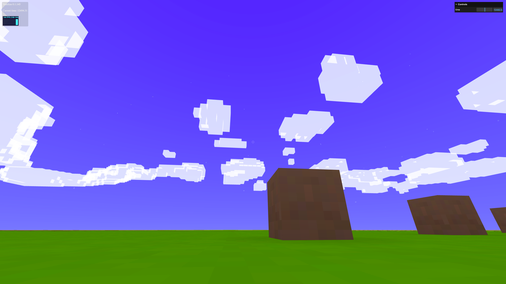
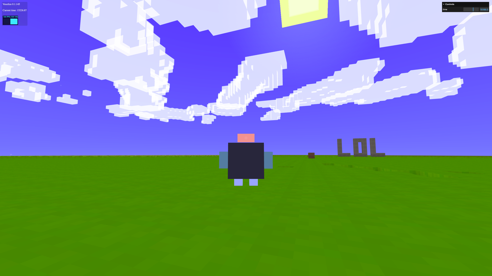
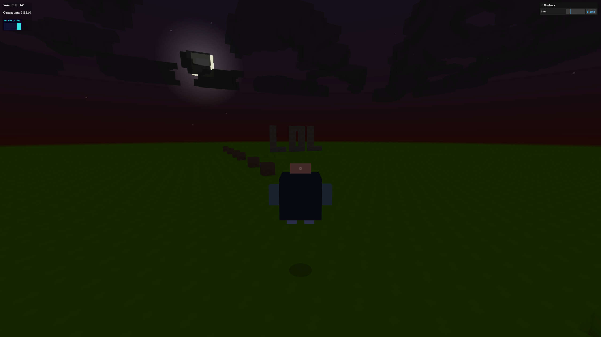

# Perspectives and Visuals

Switch between first, second, and third person views. Add a character model and lighting effects.

## Add Perspective Switching

```javascript title="main.js"
const perspectives = new VOXELIZE.Perspective(rigidControls, world);
perspectives.connect(inputs);

function animate() {
  requestAnimationFrame(animate);

  if (world.isInitialized) {
    world.update(
      camera.getWorldPosition(new THREE.Vector3()),
      camera.getWorldDirection(new THREE.Vector3())
    );

    rigidControls.update();
    voxelInteract.update();
    perspectives.update();
  }

  world.renderFrame(renderer, camera, null);
}
```

Press `C` to cycle perspectives. But you won't see anything because there's no character model yet.



## Add a Character

```javascript title="main.js"
function createCharacter() {
  const character = new VOXELIZE.Character();
  world.add(character);
  return character;
}

const mainCharacter = createCharacter();
rigidControls.attachCharacter(mainCharacter);
```

Now when you switch perspectives, you'll see your character:



## Add Shadows and Lighting

```javascript title="main.js"
const lightShined = new VOXELIZE.LightShined(world);
// What casts in the world's shadow maps besides the terrain.
const shadowCasters = [];

function createCharacter() {
  const character = new VOXELIZE.Character();
  world.add(character);
  lightShined.add(character);
  shadowCasters.push(character);
  return character;
}

function animate() {
  requestAnimationFrame(animate);

  if (world.isInitialized) {
    world.update(
      camera.getWorldPosition(new THREE.Vector3()),
      camera.getWorldDirection(new THREE.Vector3())
    );

    rigidControls.update();
    voxelInteract.update();
    perspectives.update();
    lightShined.update();
    // The sun and moon, then the shadow maps: the sun's cascades and the
    // torches' shadows, with the characters casting in them.
    world.updateShaderLighting(camera, rigidControls.object.position);
    world.renderShadowMaps(renderer, shadowCasters);
  }

  world.renderFrame(renderer, camera, null);
}
```

- `renderShadowMaps` - Draws the world's shadow maps (the sun's cascades, the torches' shadows) with the objects you pass casting
- `LightShined` - Updates object brightness based on surrounding voxel lighting



The character dims at night and casts a shadow.

Without `LightShined`, everything would stay bright (Voxelize's entity materials are unlit node materials, `MeshBasicNodeMaterial`).
