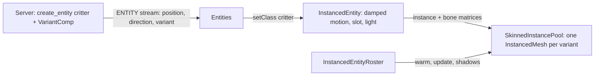

# Instanced Entities

A [custom entity](./custom-entities.md) is one three.js object per entity, which is right for a handful of bots or projectiles. A herd, a school of fish or a crowd needs **instancing**: every entity of one variant is a slot in a single `InstancedMesh`, skinned on the GPU from a bone texture. Two hundred walkers of three variants cost three draw calls.

`defineSkinnedFamily` declares such a family in one place. The engine builds the geometry from box parts, paints the atlas, skins and animates it, lights each instance from the voxel light, flashes it on hit, casts and receives shadows, and follows the server's entity stream.



## Declare the family

```ts title="critters.ts"
import * as VOXELIZE from "@voxelize/core";

export const critters = VOXELIZE.defineSkinnedFamily({
  type: "critter",
  variants: ["sand", "moss", "slate"],
  bones: ["body", "head", "legL", "legR"],
  parts: (variant) => [
    { bone: "body", size: [0.5, 0.4, 0.7], at: [0, 0.45, 0], paint: "#c9a56b" },
    { bone: "head", size: [0.32, 0.3, 0.3], at: [0, 0.7, 0.45], pivot: [0, 0.6, 0.3], paint: "#c9a56b" },
    { bone: "legL", size: [0.12, 0.25, 0.12], at: [-0.15, 0.125, 0], pivot: [-0.15, 0.25, 0], paint: "#3b2b1a" },
    { bone: "legR", size: [0.12, 0.25, 0.12], at: [0.15, 0.125, 0], pivot: [0.15, 0.25, 0], paint: "#3b2b1a" },
  ],
  animate: (pose) => {
    const swing = Math.sin(pose.time * 8) * 0.6 * pose.movement;
    pose.rotateBone("legL", swing);
    pose.rotateBone("legR", -swing);
  },
});
```

- Mesh units with the origin at the feet, +y up and +z forward.
- Each part turns about its bone's `pivot` (a hip, a neck).
- `paint` is a colour or a per-face painter; faces are `0=+x 1=-x 2=+y 3=-y 4=+z 5=-z`.
- `pose.time` is the world's shader clock, so every client poses idle motion alike. `pose.movement` eases from 0 at rest to 1 while travelling.

## Install it

```ts title="main.ts"
const roster = new VOXELIZE.InstancedEntityRoster();
world.add(roster);
critters.install({ entities, roster, world, lightAt: lightShined.lightAt });

await roster.warm({ budgetMs: 40 }); // before the player is let in

// each frame
roster.update(deltaTime, renderer);
roster.updateShadowUniforms(world.chunkRenderer.shaderLightingUniforms);
world.renderShadowMaps(renderer, roster.listShadowCasterPools());
```

## Spawn it from the server

```rust title="methods.rs"
world
    .create_entity(&nanoid!(), "critter")
    .with(PositionComp::new(x, y, z))
    .with(DirectionComp::default())
    .with(VariantComp::new("moss"))
    .build();
```

`VariantComp` is a plain component; a [metadata system](../networking/metadata-processing.md) writes it into the entity's metadata as `variant`, which is what the client reads. Motion stays on the server: move `PositionComp` and `DirectionComp` there.

## Going further

- `critters.Entity` is the generated entity class; subclass it and pass `entity: MyCritter` to `install` for per-entity state.
- `InstancedEntity` is the base class, for families with their own `SkinnedInstancePool` and `animate(time, deltaTime)`.
- `SkinnedFamilyConfig` takes per-variant bone counts, surfaces, material options, emissive faces, alpha-cut shadows and a custom texture source.

The working version of everything on this page is `examples/client/src/critters.ts` and the `spawn-critter` method in `examples/server/worlds/shared/methods.rs`. Run `pnpm demo` and call `spawnCritters(x, y, z, 50)` in the console.
